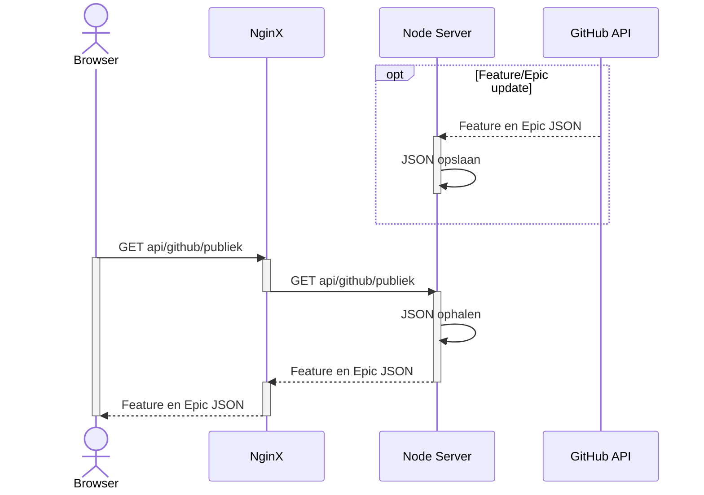
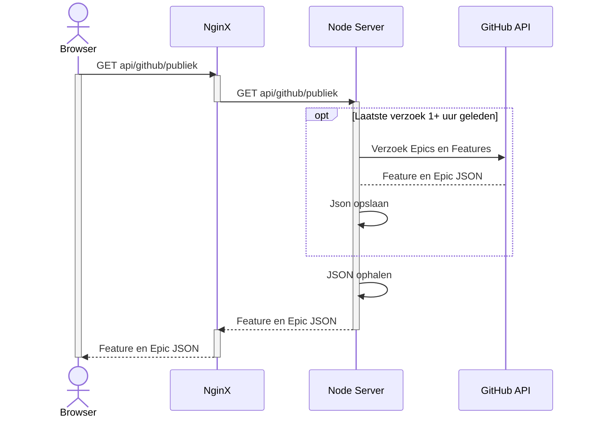
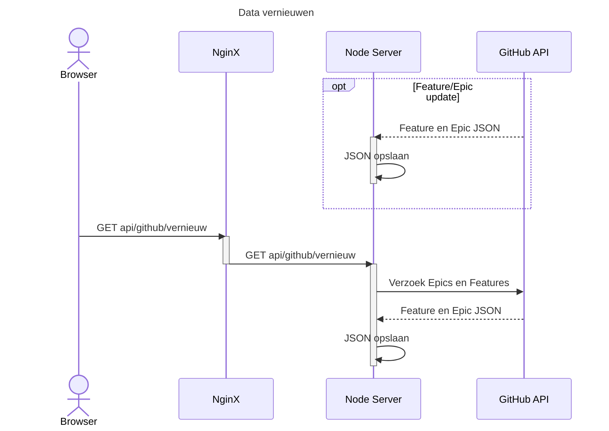
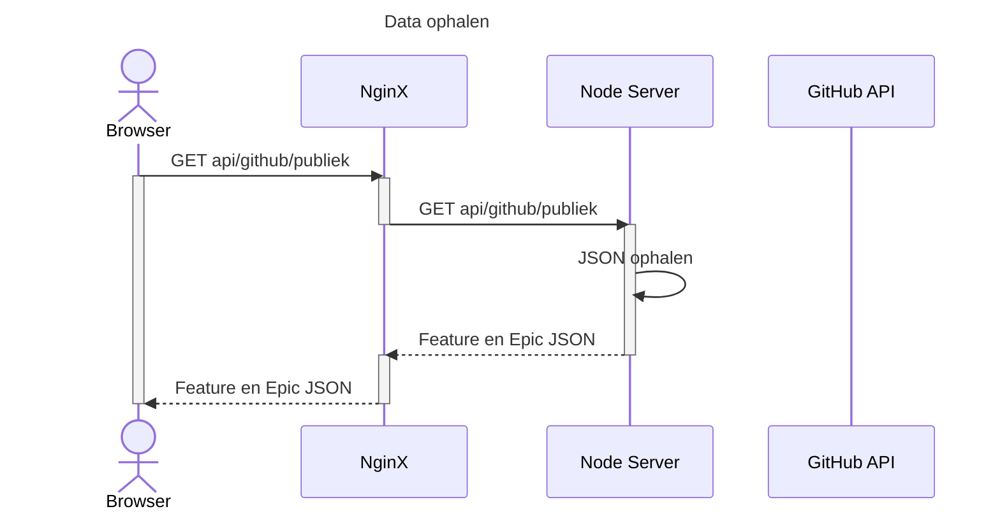

# GitHub API Communicatie

Voor het project moeten we Features en Epics vanuit GitHub renderen in de gebruikers browser. Dit kan gedaan worden door middel van API calls of Webhooks.

## API Calls

Als een gebruiker een oproep doet naar de api voor de Features en Epics, kunnen we eerst kijken hoe oud de opgeslagen informatie is. Dan als het ouder is dan een gezette duratie, doen we eerst een API call naar GitHubs servers. Dan slaan we de resultaten van dat verzoek op en geven we de gebruiker de correcte informatie. Als het niet ouder is geven we de gebruiker gewoon direct de opgeslagen informatie en doen we nooit een API call naar GitHubs servers.

Diagram: [API Call Diagram](#api-call-diagram)

### API Call voordelen

- Simpel om op te zetten

### API Call nadelen

- Informatie is minder recent

    Als iemand een verzoek maakt voordat de duratie af is, krijgen ze oude informatie. Zelfs als er al nieuwe informatie op GitHub staat.
- Maakt onnodige verzoeken

    Met deze methode moet je periodiek nieuwe verzoeken maken. Maar de meeste van deze verzoeken zullen waarschijnlijk geen veranderingen bevatten. Dat zijn dus een hoop extra verzoeken dan nodig is

## Webhooks

Bij webhooks stuurt GitHub automatisch de informatie als een Feature of Epic wordt geupdate in GitHub. Dus als een gebruiker een oproep doet naar het api, kan de server gewoon direct de opgeslagen data mee geven

Diagram: [Webhook Diagram](#webhook-diagram)

### Webhooks voordelen

- Informatie is zo recent als het kan

### Webhooks nadelen

- Lastiger om op te zetten, vooral in development
- Updates kunnen gemist worden

    Als GitHub een update krijgt, terwijl de MijnInkomen servers om een of andere reden offline staan. Wordt de opgeslagen informatie niet hernieuwd. Dus dan is de informatie op de website oud totdat er een nieuwe update op GitHub komt.

## Implementatie

De beste keuze voor ons gebruik zal een combinatie van beide zijn. Het systeem zal normaal gebruik maken van Webhooks, maar wanneer iemand met admin rechten handmatig een API call doet naar de server, wordt er gebruik gemaakt van een API call. Hierdoor kunnen de meeste updates automatisch gebeuren op een efficïente manier en blijft de data op de server recent. En dan als er een fout gebeurt in dit automatische systeem, kan de website nog steeds handmatig hernieuwd worden.

Diagrammen: [Implementatie Diagrammen](#implementatie-diagrammen)

## Diagrammen

*auth*: In deze diagrammen wordt auth geskipt voor overzichtelijkheid. Auth zou altijd gebeuren voordat nginx een verzoek doet naar de node server.
*endpoints*: De adressen benoemd in deze diagrammen, `api/github/publiek` bijvoorbeeld, zijn nog niet vast en voornamelijk bedoelt als voorbeeld.

### Webhook Diagram

### API Call Diagram

### Implementatie Diagrammen

---

