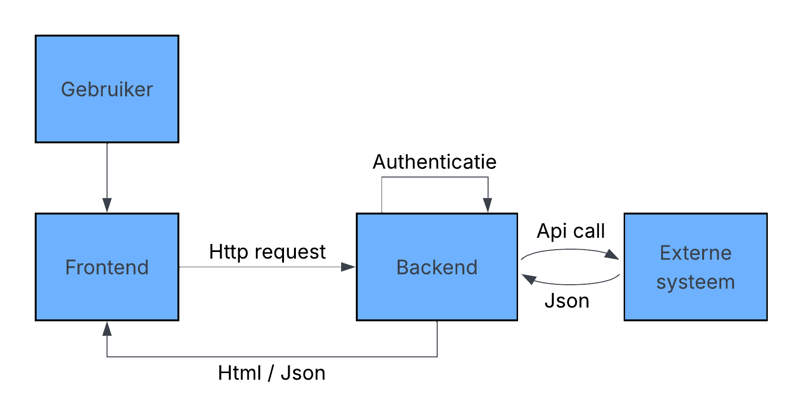
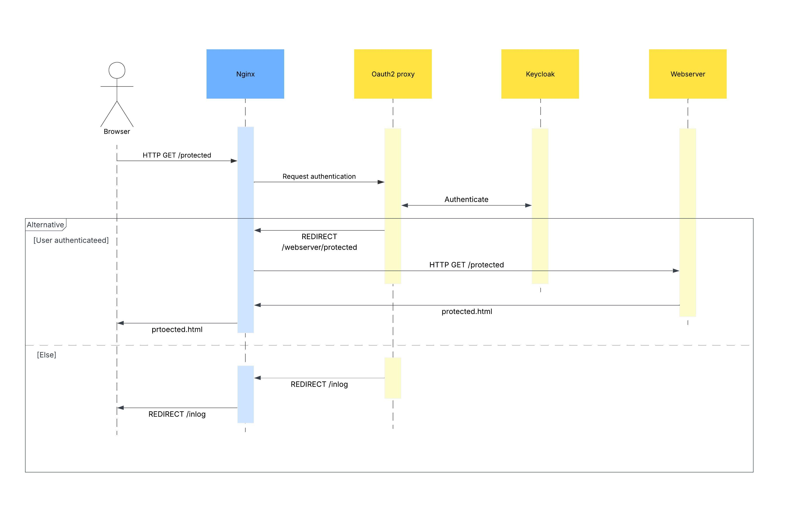

# Inhoudsopgave

- [Inhoudsopgave](#inhoudsopgave)
  - [Technische Overzicht](#technische-overzicht)
    - [Backend Systemen](#backend-systemen)
    - [Externe Systemen](#externe-systemen)
  - [Use case diagram](#use-case-diagram)
  - [Sequence Diagram](#sequence-diagram)
  - [Deployment diagram](#deployment-diagram)

## Technische Overzicht

Binnen deze versimpelde schets van de technische context in het project, kun je zien dat gebruikers kant alleen html, of mogelijk json maar verder daarin later, bestanden krijgt. Gebaseerd op of de url die de gebruiker bezoekt afgesloten is of niet, wordt in de backend de authenticatie en authorisatie behandelt. Voor de meeste afgesloten url's zit de nodige informatie in het externe systeem. De backend doet dan een API-call naar dat systeem, en verkrijgt daarvan een Json bestand terug. Die daarna wordt gebruikt voor het behandelen van de gebruikers hun request.

### Backend Systemen

- Nginx (Reverse proxy gebruikt voor het verdelen van de requests)
- OAuth2 proxy (Reverse proxy gebruikt voor het behandelen van auth-requests)
- Postgres SQL x2 (Database gebruikt voor het opslaan van gebruikers inlog informatie en registratie aanvragen)
- Keycloak (Open source applicatie voor het behandelen van authenticatie en authorisatie)
- Docusaurus (web-framework voor het bouwen van de website)
- Node server (Http-server voor het behandelen van registratie aanvragen)

### Externe Systemen

- Jira (Samenwerkingsplatform binnen de overheid en de bron voor de Epics en Features waar aan gewerkt moet worden)
- Github (Werkplatform binnen de overheid en de plaats waar Epics en Features opgeslagen zullen worden)

## Use case diagram

Hier binnen zie je drie actoren: geïnteresseerde gemeenten, deelnemers en ontwikkelaars, deze noemen wij respectief niveau-1, niveau-2 en niveau-3. Binnen deze use diagram is duidelijk te zien hoe niveau-1 alleen toegang krijgt tot de algemene informatie: wat is MijnInkomen; wat kan MijnInkomen; hoe doe ik mee aan MijnInkomen. In niveau-2 heb je daarnaast ook toegang tot het afgesloten deel van het platform. Hierbij kun je kijken naar de status van de Roadmap en verschillende items, features en epics, binnen de roadmap. Daarnaast kun je ook feedback geven op de roadmap. Het enige dat niveau-3 extra kan is het beheren van de backlog, en dus roadmap, en het inzien van de issues achter de features en epics.

## Sequence Diagram

<!-- Klopt niet helemaal FIX na feedback sequence diagram -->
In deze sequence diagram kun je zien hoe een GET request naar een beschermde url wordt behandelt in de backend. Als eerst wordt de http-request gestuurd naar de nginx-server. Die ziet dat deze url afgesloten is, dus verstuurd het deze request door naar de oauth2-server. Die checkt met de keycloak-server of de gebruiker de juiste authenticate bevat om de url te bezoeken. Als de browser deze authenticatie niet bevatten, reageert de oauth2-server met een redirect naar de inlog pagina. Die wordt dan door verstuurd via de nginx-server. Als de browser de authenticatie wel bevat, reageert de oauth2-server met een redirect naar het originele doel. De webserver krijgt deze request dan binnen en reageert met het beschermde bestand, waarna de nginx-server deze door verstuurd naar de browser.

## Deployment diagram

In deze deployment diagram is te zien welke servers: waar zijn, wie ze beheren en beknopt wat ze doen. Er is te zien dat lokaal nog alles draait op docker. Maar in de omgeving in de toekomst, na het project, is het nog onduidelijk waar wat draait en wie wat beheert. Zo is het ons nog niet duidelijk of de opdrachtgever hun eigen server heeft, of een cloud service zal gebruiken voor het hosten. Daarnaast is het ook nog niet duidelijk wie deze server dan zal beheren. Tot slot kun je in de diagram zien dat we hebben Vercel willen gebruiken als deployment naar een testomgeving. Hierdoor kan de opdrachtgever naar een specifieke url om de website uit te testen, in plaats van dat die moet wachten op een lokale demo van het systeem.
